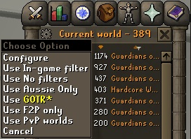
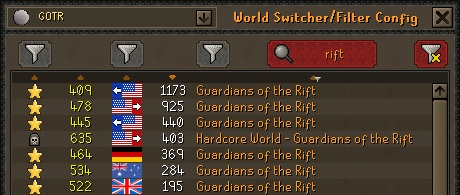
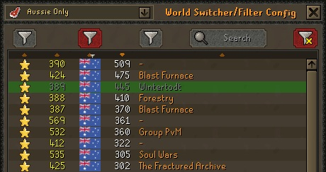
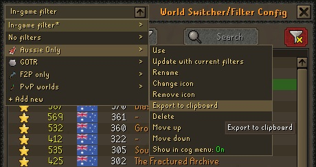

# World Filter Presets



Ever find yourself changing your world filters for one thing, then changing them all back again afterwards? World Filter Presets lets you save those filters and swap between them whenever you want, nice and easy.

To configure, open the `Configure World Switcher` popup and use the custom dropdown to pick a preset, or click **+ Add new** to save your current filters as a new one. **In-game filter** takes you back to your normal in-game filters.

You can also quickly swap presets straight from the world hopper by right-clicking the cog, so you don't even need to open the menu to swap!

## Presets for whatever activity you're doing

You can add as many presets as you want, mix and match filters and search terms. Here are some examples:

- **No filters** shows all worlds. Super handy when you just want to quickly swap between your current filter and the full world list.
- **Themed worlds** remembers search terms, so you can filter by activity.



- **Region worlds** remembers your selected region filters, so you can easily show only the low-ping regions.



## Custom preset names and icons

Give each preset a name up to **80 characters** long, and even optionally choose an in-game item icon to show alongside it. Makes it a bit easier to spot the preset you're looking for at a glance!

Hover or right-click a preset to rename it, change its icon, move it up or down, or choose whether it shows up in the cog menu.

## Sharing presets

Got a filter you want to share with a mate? Just like tile markers, you can copy a preset to your clipboard and send it over. They can then import it from their clipboard, nice and easy. (Yes it asks if you want to import, and confirms replacements if you re-import something that already exists but is slightly different)

Right-click a preset and choose **Export to clipboard** to copy one, or right-click the dropdown and choose **Export all presets** to copy all of your custom presets. To import one or many presets, copy the shared text and choose **Import from clipboard** on the dropdown.



The format is Here's a simple **Aussie Only** preset you can copy and import:

```json
{"v":"wfp-1","presets":[{"name":"Aussie Only","icon":2132,"filters":{"country": 1503}}]}
```

---

## AI usage

I want to acknowledge and disclose the use of AI agentic engineering in creating this plugin. 

The code was written using OpenAI's Codex with **GPT-6.1 Sol** and **GPT-6.1 Terra**.
